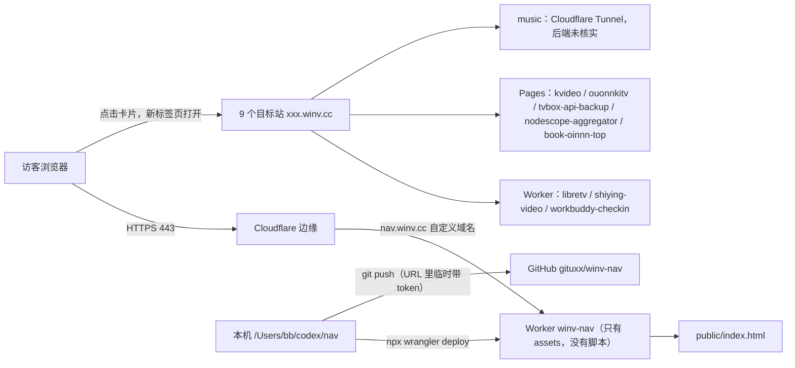

# AGENT-HANDOFF — winv-nav 详细技术交接

> **最后核对日期：2026-11-18 22:14（CST）**。本文所有线上状态都是这个时间实际调用 Cloudflare / GitHub API 或 curl 得到的；查不到的写“未核实”。
> 登录信息见 `CREDENTIALS.local.md`。

## ⚠️ 最显眼的问题

1. **子域名会被其他项目的部署“顺手删掉”（已经发生过）。** `libretv.winv.cc`、`shiying.winv.cc`、`checkin.winv.cc` 是 2026-11-16 用 API 手动挂到其他项目的 Worker 上的。那些项目自己的 `wrangler.jsonc` 里只有 `*.oinnn.top` 的路由，所以它们一旦重新 `wrangler deploy`，wrangler 会把配置里没写的自定义域名删掉。
   - 2026-11-18 核对时 `libretv.winv.cc` 已经打不开：libretv 这个 Worker 在 2026-11-18T01:13:50Z 被重新部署过。当天 22:14 已手动恢复，绕过本机代理验证返回 200。
   - 是谁触发了那次部署，未核实：libretv 仓库里没有 `.github/workflows`，可能是 NAS 上的部署脚本或别的 Agent。
   - 根治方案见“待决事项 1”。
2. **本机 curl 结果不可信的情况**：本机开了 TUN/fake-ip 代理，DNS 会解析到 `198.20.x.x`。新恢复的域名可能因为代理缓存而一直显示 `000`，但实际上是好的。要用下面的命令绕过代理检查：

   ```bash
   IP=$(curl -s -H 'accept: application/dns-json' "https://1.1.1.1/dns-query?name=libretv.winv.cc&type=A" | python3 -c "import sys,json;print([a['data'] for a in json.load(sys.stdin).get('Answer',[]) if a['type']==1][0])")
   curl -s -o /dev/null -w "%{http_code}\n" --resolve libretv.winv.cc:443:$IP https://libretv.winv.cc/
   ```

   代理开启的记录对外都会解析到 Cloudflare 的 A 记录 IP，所以这里取 type=1 那条。如果 DoH 也返回 000 或 5xx，就说明真坏了：Worker 域名先用 9.6 看映射还在不在，不在就按 9.5 挂回；Pages 域名用 9.6 看 DNS 记录和 Pages 的 domains。

3. **代码与部署一致性**：一致。本地 HEAD、GitHub `main` 和线上内容都是 `8be0dda`；`curl https://nav.winv.cc/ | diff - public/index.html` 没有差异。本地没有未提交的改动（这次文档工作提交之前）。

---

## 1. 当前状态表（2026-11-18 22:14）

| 项 | 状态 | 说明 |
|---|---|---|
| nav.winv.cc（本项目） | ✅ 200 | Worker `winv-nav`，当前版本 `9e75e502-0806-4eee-8863-e609c859b2c3`，部署于 2026-11-16T06:51:45Z |
| libretv.winv.cc | ⚠️ 已恢复 | 22:14 前打不开，原因见上；本机直接 curl 仍可能显示 000（代理缓存） |
| kvideo / ouonnkitv / tvbox / node / book .winv.cc | ✅ 200 | Pages 项目的自定义域名，比较稳定，不受重新部署影响 |
| shiying / checkin .winv.cc | ✅ 200 | Worker 自定义域名，**有和 libretv 一样的被删风险** |
| music.winv.cc | ✅ 200 | 不是本项目创建的：CNAME 指向一个 Cloudflare Tunnel（`c11cf3c0-...cfargotunnel.com`），后端可能在 NAS 上，未核实 |
| “看起来正常、实际不正常” | — | ① 某个 Worker 被重新部署后，它的 winv.cc 域名会悄悄消失，而导航页本身仍然显示正常；② checkin 返回 200 只是登录页，功能是否可用未核实 |

## 2. 源代码与版本

- 本地：`/Users/bb/codex/nav`，git 分支 `main`，**没有配置 remote**（这是故意的，免得 token 进 `.git/config`）。
- 远程仓库：https://github.com/gituxx/winv-nav （公开），默认分支 `main`。
- 获取代码：`git clone https://github.com/gituxx/winv-nav.git`
- 被 git 跟踪的文件：`README.md`、`public/index.html`、`wrangler.jsonc`，以及本次新增的文档。`.wrangler/` 是 wrangler 的缓存目录，已加入忽略。
- 工具：Node v24.14.0（nvm），wrangler 4.164.0（通过 `npx -y` 临时下载，没有 package.json）。

## 3. 系统架构



没有后端，没有数据库，没有自定义端口。

## 4. 核心流程

1. **访问**：浏览器请求 `nav.winv.cc` → Cloudflare 把 Worker `winv-nav` 的静态资源 `index.html` 原样返回（所有路径都返回这个文件，没有自定义 404）→ 页面内的 JS 根据 `D` 数组渲染卡片，写进 `#m` → 用户点击卡片，在新标签页打开目标站。
2. **发布**：编辑 → `npx wrangler deploy`（上传 `public/`，生成新版本，100% 流量切过去）→ 用 curl 验证 → `git commit` 和 push → 更新 CHANGELOG。

## 5. 代码地图

| 文件 | 职责 |
|---|---|
| `public/index.html`（57 行） | 整个站点。第 4–25 行是 CSS（`:root` 里的变量；第 23 行深色模式；第 24 行在宽度 ≤520px 时改成两列）；第 26–30 行是骨架，只有一个渲染容器 `<div id="m">`；第 31 行开始是脚本 |
| ├ `const I`（第 32 行起） | 线条 SVG 图标库，键名有 tv / film / pop / play / music / radio / globe / book / check。图标是自己手写的 path，Lucide 风格但不是从 Lucide 复制的 |
| ├ `const C`（第 42 行） | 马卡龙配色，每项是 `[背景色, 图标色]`，按卡片顺序循环使用 |
| ├ `const D`（第 43–54 行） | **数据**：`[分组名, [[图标键, 名称, 简介, 子域名前缀], ...]]`，链接会拼成 `https://${前缀}.winv.cc/` |
| └ 第 56 行 | 渲染代码 |
| `wrangler.jsonc` | Worker 名 `winv-nav`，`assets.directory=./public`，路由 `nav.winv.cc`（custom_domain） |
| `README.md` | 简短说明 |

改代码时容易出错的地方：
- 第 56 行的渲染只会拼 `.winv.cc` 结尾的链接。如果要放非 winv.cc 的站点，得改数据结构。
- 新增的图标键必须在 `I` 里存在，否则卡片里的图标会是空白。
- 用 sed 批量替换域名时要小心：曾经把 `kvideo.oinnn.top` 替换成了 `kshiying.winv.cc`（见踩坑 4）。
- `public/` 里的所有文件都会公开，不要往里放任何别的东西。

## 6. 本地开发环境

```bash
cd /Users/bb/codex/nav
python3 -m http.server -d public 8080   # 打开 http://localhost:8080
# 或者：npx -y wrangler dev
```

本机环境的坑：
- **shell 是 zsh**：`for x in "a b c"; do set -- $x` 不会按空格拆开，要用 `bash <<'EOS' ... EOS` 包起来跑。另外 `--include=*.ts*` 这种通配符没有匹配时会直接报错退出。
- **本机代理**：TUN/fake-ip 模式会让 dig 和 curl 解析到 `198.20.x.x`，新域名的检测结果可能因为缓存而不准（见上方第 2 点）。
- 当前的 wrangler 运行 `wrangler pages deploy` 时会提示“Pages 已并入 Workers”，并且在非交互环境下直接报错。

## 7. 服务器与外部资源清单

| 资源 | 值 | 怎么检查 | 坏了怎么修 |
|---|---|---|---|
| Cloudflare Worker `winv-nav` | assets-only | `npx wrangler deployments list` | 重新 `npx wrangler deploy`，或者 `wrangler rollback` |
| 自定义域名 nav.winv.cc | Workers Custom Domain，DNS 自动生成（AAAA 100::，代理开启），证书由 Cloudflare 自动签发 | `curl -I https://nav.winv.cc` | `wrangler deploy` 会根据 `wrangler.jsonc` 自动重建 |
| winv.cc 域名 | Cloudflare Free 套餐，NS 是 dakota/elisa.ns.cloudflare.com；注册商是广州云讯，**到期日 2032-08-01**（whois） | `whois winv.cc` | 续费需要注册商账号，未提供 |
| GitHub 仓库 | gituxx/winv-nav（公开） | `git ls-remote https://github.com/gituxx/winv-nav.git main` | 用本地仓库重新推送 |
| 服务器 | 不适用（本项目没有服务器） | — | — |

## 8. 共用资源边界（不属于本项目，不要动）

同一个 Cloudflare 账号（972d4e…）下还有：
- **Worker**：libretv、shiying-video、workbuddy-checkin、edgetunnel、edge-mini、nodescope-collector、cccat-daily-checkin
- **Pages 项目**：kvideo、ouonnkitv、tvbox-api-backup、nodescope-aggregator、book-oinnn-top
- **域名**：整个 oinnn.top
- **winv.cc 下其他项目的记录**：
  - `video.winv.cc`（A 记录 43.135.184.100，不经过 Cloudflare 代理，归属未核实）
  - `music.winv.cc`（指向 Tunnel）
  - book、node、kvideo、ouonnkitv、tvbox 这几个 CNAME，以及 libretv、shiying、checkin 的 Worker 域名

**唯一允许的操作**是给上面这些项目的 Worker 或 Pages 项目“挂上 / 恢复”对应的 `*.winv.cc` 域名，用户 2026-11-16 授权过（见操作手册 9.5）。不要改它们的代码、配置、环境变量，也不要重新部署它们。

同一个 GitHub 账号 gituxx 下还有另外 20 个仓库，都不属于本项目。

## 9. 操作手册

先设置环境变量（三个变量的值见 CREDENTIALS.local.md 第 1 节）：

```bash
cd /Users/bb/codex/nav
export CLOUDFLARE_EMAIL=... CLOUDFLARE_API_KEY=... CLOUDFLARE_ACCOUNT_ID=...
```

### 9.1 部署

```bash
npx -y wrangler deployments list | tail -5   # 先记下当前版本 ID（回滚用）
git add -A && git commit -m "..."            # 先提交，git 历史就是备份
npx -y wrangler deploy         # 输出里有 "Current Version ID: xxx"，记下来
sleep 5; curl -s https://nav.winv.cc/ | diff -q - public/index.html && echo OK
# 再跑一遍 9.3 的验证，然后推送并更新 CHANGELOG
git push https://<TOKEN>@github.com/gituxx/winv-nav.git main
```

### 9.2 回滚

```bash
npx -y wrangler deployments list              # 找到上一个版本 ID
npx -y wrangler rollback <version-id> -m "原因"
# 或者用 git 回滚代码再部署：
git revert HEAD && npx -y wrangler deploy && git push https://<TOKEN>@github.com/gituxx/winv-nav.git main
```
回滚后同样要跑一遍 9.3 的验证，并在 CHANGELOG 里记一笔。注意：`wrangler rollback` 只回滚线上版本，本地代码不会跟着变，之后要把 git 也改成一致。

“修改前先备份”在本项目里就是：部署前确认改动已经 commit，并记下当前的版本 ID。

### 9.3 测试 / 验证（什么才算通过）

1. `curl https://nav.winv.cc/ | diff - public/index.html` 没有差异。
2. 下面这条命令里的 10 个子域名都返回 200（如果遇到 000，用第 2 点的 DoH 方法复查）：
   ```bash
   for u in nav libretv kvideo ouonnkitv music book node checkin shiying tvbox; do echo $u $(curl -s -o /dev/null -w "%{http_code}" -m 10 https://$u.winv.cc/); done
   ```
3. 用浏览器真正打开 https://nav.winv.cc ，确认：
   - 卡片和图标都显示正常（浅色、深色两种模式）
   - 手机宽度下是两列
   - 点开随便几个卡片，能进到真实页面

### 9.4 升级依赖

没有依赖。wrangler 用 `npx -y` 每次拉最新版。如果新版行为变了，可以固定版本：`npx -y wrangler@4.164.0 deploy`。

### 9.5 恢复某个被删掉的 `*.winv.cc` Worker 域名（最常见的运维操作）

```bash
# 示例：libretv。shiying 对应 shiying-video，checkin 对应 workbuddy-checkin
curl -s -H "X-Auth-Email: $CLOUDFLARE_EMAIL" -H "X-Auth-Key: $CLOUDFLARE_API_KEY" -H "Content-Type: application/json" \
  -X PUT https://api.cloudflare.com/client/v4/accounts/$CLOUDFLARE_ACCOUNT_ID/workers/domains \
  -d '{"hostname":"libretv.winv.cc","service":"libretv","zone_id":"6c67b3a052599b68364dacc7db6b389c","environment":"production"}'
```

如果是 Pages 项目的域名丢了：`POST /accounts/$CLOUDFLARE_ACCOUNT_ID/pages/projects/<项目名>/domains`，body 是 `{"name":"x.winv.cc"}`；再加一条代理开启的 CNAME，指向 `<项目>-xxx.pages.dev`（pages.dev 地址带随机后缀，比如 `tvbox-api-backup-4ey.pages.dev`。用这条查：`curl -s "${H[@]}" https://api.cloudflare.com/client/v4/accounts/$CLOUDFLARE_ACCOUNT_ID/pages/projects/<项目名> | python3 -c "import sys,json;print(json.load(sys.stdin)['result']['subdomain'])"`，其中 H 的定义见 9.6）。新挂上的 Pages 域名大约 1 分钟内会返回 522，属于正常现象。

### 9.5b 新增一个站点（比如 Pages 项目 foo → foo.winv.cc）

1. 先在 winv.cc 下挂好域名。Pages 项目按 9.5 的后半段做（POST domains，再加一条 CNAME 指向 API 查到的 subdomain）；Worker 项目按 9.5 的 PUT 做。用户要求“把我的站映射到 winv.cc”，这属于已授权的操作；但目标项目本身的代码和配置仍然不能动。
2. 在 `public/index.html` 的 `D` 里加一行 `["图标键","名称","简介","foo"]`。图标键必须在 `I` 里存在，没有合适的就照着现有风格手写一个 24×24 的线条 path。分组以用户指定的为准；用户没指定时，按“影音 · 阅读 / 工具”的含义放，并在汇报里说明。
3. 部署，跑 9.3 的验证（记得把 foo 加进 for 循环）。
4. 同步更新这些文档：AGENTS.md（站点数量、红线清单、常用命令里的 for 循环）、本文档的第 1、3、8、9.3 节、`docs/项目说明.md` 的站点表、CHANGELOG。
5. 本文里的行号（比如 `D` 在第 43–54 行）一改代码就会变，改完顺手更新。

### 9.6 查看所有 winv.cc 的映射

（winv.cc 的 zone_id 可以这样查：`curl -s "${H[@]}" "https://api.cloudflare.com/client/v4/zones?name=winv.cc" | python3 -c "import sys,json;print(json.load(sys.stdin)['result'][0]['id'])"`）


```bash
H=(-H "X-Auth-Email: $CLOUDFLARE_EMAIL" -H "X-Auth-Key: $CLOUDFLARE_API_KEY")
curl -s "${H[@]}" "https://api.cloudflare.com/client/v4/accounts/$CLOUDFLARE_ACCOUNT_ID/workers/domains" | python3 -m json.tool | grep -E '"hostname"|"service"'
curl -s "${H[@]}" "https://api.cloudflare.com/client/v4/zones/6c67b3a052599b68364dacc7db6b389c/dns_records?per_page=100" | python3 -c "import sys,json;[print(r['type'],r['name'],r['content']) for r in json.load(sys.stdin)['result']]"
```

## 10. 从零重建

如果本机没了：

```bash
git clone https://github.com/gituxx/winv-nav.git && cd winv-nav
export CLOUDFLARE_EMAIL=... CLOUDFLARE_API_KEY=... CLOUDFLARE_ACCOUNT_ID=...
npx -y wrangler deploy
```

这样会自动重建 Worker 和 nav.winv.cc 的域名。凭据需要找用户重新要。

如果 Cloudflare 账号没了：换新账号后，要把 winv.cc 的 NS 改到新账号（需要注册商账号，未提供），再部署一次；其他 9 个目标站各自重建，不属于本项目。

## 11. 监控

- **现状：没有任何监控。**
- 缺少的：
  - 10 个子域名的可用性探测。最该补的是 libretv、shiying、checkin 这三个 Worker 域名有没有被删。
- 建议（待决事项 2）：
  - 用 UptimeRobot 免费版，或者在 GitHub Actions 里定时 curl
  - 更省事的做法：在本仓库加一个 Action，用 Cloudflare API 检查域名在不在，不在就自动挂回去

## 12. 测试体系

没有自动化测试，因为只有一个静态文件。验证全靠 9.3 的三步。**部署命令返回成功不算通过，必须完成第 3 步，用浏览器真实打开。**

## 13. 踩坑记录

| # | 现象 | 原因 | 解决 |
|---|---|---|---|
| 1 | `wrangler pages project create` 加 `pages deploy` 报 “cannot be run in a non-interactive context”，接着 “Project not found” | wrangler 4.x 想把 Pages 引导到 Workers，非交互环境下直接失败 | 改用 Workers 静态资源加 `wrangler deploy`。**不要用 `--force` 强行走老 Pages** |
| 2 | 为 Pages 先建的 CNAME `nav → winv-nav.pages.dev` 成了孤儿记录，会和 Worker 自定义域名冲突 | Pages 项目没建成 | 已删除，然后由 Worker 的 custom_domain 自动建 DNS |
| 3 | `tvbox.winv.cc` 返回 403 | 原来的 CNAME 指向了 `tvbox-api-backup.pages.dev`，而真实地址是 `tvbox-api-backup-4ey.pages.dev`，而且没有在 Pages 项目里挂自定义域名 | 删掉旧记录，在 Pages 挂上域名，CNAME 改成指向 `-4ey`。**pages.dev 的子域名有随机后缀，要以 API 返回的为准** |
| 4 | 导航里出现 `kshiying.winv.cc` | 用 sed 把 `video.oinnn.top` 替换成 shiying 时，误伤了 `kvideo.oinnn.top` | 已修正。批量替换要加单词边界，替换完 grep 一遍所有链接 |
| 5 | zsh 下 `set -- $x` 没有拆分，hostname 变成 `.winv.cc` | zsh 默认不做单词拆分 | 用 `bash <<'EOS'` 执行 |
| 6 | 新挂的 Pages 域名返回 522 | 自定义域名在验证、证书在签发 | 等 1 分钟左右就好了 |
| 7 | `libretv.winv.cc` 消失（2026-11-18） | libretv 项目重新 `wrangler deploy`，会同步删掉配置里没写的 custom domain | 按 9.5 恢复；根治见待决事项 1 |
| 8 | 恢复后本机 curl 一直返回 000，报 SSL_ERROR_SYSCALL | 本机 fake-ip 代理的缓存 | 用 DoH 拿到真实 IP，再加 `--resolve` 验证 |
| 9 | `video.winv.cc` 已被占用 | 已有一条 A 记录指向 43.135.184.100，归属不明 | 视映改用 `shiying.winv.cc`，没动 video |

## 14. 待决事项（需要用户决定）

| # | 事项 | 方案 | 优点 | 缺点 |
|---|---|---|---|---|
| 1 | 防止 libretv / shiying / checkin 的 winv.cc 域名被它们自己的部署删掉 | A. 在这三个项目的 `wrangler.jsonc` 的 routes 里加上 `*.winv.cc` | 一次改完就能根治 | 要改其他项目的仓库，超出本项目边界，需要用户同意 |
| | | B. 给本仓库加一个定时 GitHub Action，检查并自动挂回 | 不碰其他项目 | 要把 Cloudflare 凭据放进 GitHub Secrets；最多有一个检查周期的中断 |
| | | C. 维持现状，发现了再手动恢复 | 零成本 | 会悄悄坏掉 |
| 2 | 要不要加可用性监控 | UptimeRobot 免费版 / GitHub Actions 定时 curl / 不加 | 坏了能及时知道 | 要注册账号或配置凭据 |
| 3 | 轮换两个权限过大的凭据（都在聊天里明文出现过） | 换成限定权限的 CF API Token 和 fine-grained GitHub PAT | 安全 | Global Key 可能也被其他项目使用，未核实。排查办法：在 gituxx 的各个仓库的 Settings › Secrets 和 NAS 的部署脚本里搜 `CLOUDFLARE_API_KEY`（需要用户确认）。换成 Token 后，9.5/9.6 的请求头要改成 `-H "Authorization: Bearer $CLOUDFLARE_API_TOKEN"` |
| 4 | `video.winv.cc`（43.135.184.100）还要不要 | 保留 / 改成指向视映 / 删除 | — | 归属未核实 |
| 5 | WorkBuddy 签到面板要不要公开放在导航上 | 保留 / 下架 | — | 它是个人多账号面板 |
| 6 | 原来的 `*.oinnn.top` 域名是否保留 | 保留（现状）/ 逐步只留 winv.cc | — | — |

## 15. 已否决的方案（不要再试）

- **现成的开源导航项目**（WebStack、Sun-Panel 等）：功能太重，用户要求也不高，单文件就够了。
- **Cloudflare Pages 直传**：被 wrangler 4.x 拦截（踩坑 1）。用 `--force` 能走通，但 wrangler 明确不建议，所以没用。
- **深色紫色渐变、光斑、磨砂玻璃、emoji 图标、大时钟、问候语、搜索框**（commit `df9f1b4`）：用户评价“AI 味太浓”。
- **纯文字列表、衬线标题、米白纸张风**（commit `9c7c506`）：用户觉得太素，想要有图标的。
- **导航里列出 OpenClaw 的 7 个仓库**：用户说没必要。
- **把视映挂到 `video.winv.cc`**：这个名字已经被一条不明 A 记录占用。

## 16. 开发遗留资源

| 资源 | 状态 |
|---|---|
| CNAME `nav.winv.cc → winv-nav.pages.dev` | 2026-11-16 已删除 |
| Pages 项目 `winv-nav` | 从未建成，无需清理 |
| `/tmp/r/{libretv,kvideo,ouonnkitv}`（只读查看源码用的浅克隆，`.git/config` 里含 token） | 2026-11-18 本次已删除 |
| 本机 `~/Library/Preferences/.wrangler/logs/` | wrangler 日志，无敏感信息，可以忽略 |
| 本项目 `.wrangler/tmp` | 缓存，已加入 `.gitignore` |
| 给其他项目挂的 winv.cc 域名 | 这是正式功能，不是临时资源，需要保留 |

## 17. 术语表

- **导航 / nav**：本项目，也就是 nav.winv.cc。
- **目标站**：导航里列出的 9 个站。
- **Worker 自定义域名（Custom Domain）**：Cloudflare 直接把某个 hostname 绑到 Worker 上，DNS 记录是自动生成的 `AAAA 100::`。
- **assets-only Worker**：只有静态资源、没有 `main` 脚本的 Worker，功能上等同于 Pages。
- **oinnn.top**：用户的另一个域名，目标站最早挂在这个域名下。
- **视映**：shiying-video，用户说它本质是“视频在线解析”。

## 18. 历史时间线

| 时间（CST） | 事件 |
|---|---|
| 2026-11-16 14:04 | 用户提出需求，拿到 CF / GitHub 凭据，盘点出 21 个仓库、8 个 Worker、5 个 Pages 项目 |
| 14:05 | 尝试 Pages 失败，改用 Worker 静态资源，nav.winv.cc 上线；创建公开仓库 gituxx/winv-nav |
| 14:11 | 去掉 OpenClaw 分组 |
| 14:18 | 把所有目标站映射到 winv.cc，修复 tvbox 的 403，视映用 shiying |
| 14:37 | 加入 music.winv.cc（Any Listen）；回答用户的问题：三个影视站的设置只存在各自浏览器的 localStorage / IndexedDB 里，没有服务端存储 |
| 14:41 → 14:46 | 三轮改版：渐变玻璃风（被否：AI 味）→ 纯文字风（被否：太素）→ 小清新图标风（保留） |
| 14:51 | 按用户要求重新分组（5 + 4） |
| 2026-11-18 22:13 | 写交接文档；发现并恢复了 libretv.winv.cc |

原始聊天记录（只用来追溯历史，接手不需要读它）：`/Users/bb/.gemini/antigravity/brain/2bc1f53d-23c5-41b2-b8a1-b2cb2ca9dd43/.system_generated/logs/transcript.jsonl`。⚠️ 里面有明文凭据，不要外传。没有更早的交接资料。
